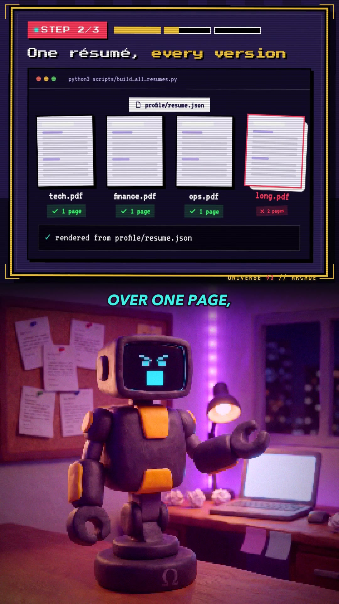

# Omega Reels: Claymation Repo Explainers

A pipeline that turns an open-source GitHub repo into a 65-second vertical claymation reel: a clay duo (Ian and his deadpan desk robot, Omega) argues below while a code-drawn UI card above shows what the tool really does, jumping to a new "universe" at every step.



## Why

Short videos about developer tools tend to be either screen recordings nobody finishes or AI clips that cost a fortune and make things up. This pipeline keeps the paid model calls to the minimum: Ian's lip-synced shots and the voice lines. Everything else is code: Omega's face, the UI cards, the universe jumps, the music and the sound effects, the grade and the mix. A reel costs about 140 Higgsfield credits instead of about 600, the cards only show real commands and file names from the repo's README, and any stage can be rebuilt without paying again.

## Features

- **Script rules that hold up across reels** (`scripts/STYLE.md`): who the two characters are, a 65 s structure (cold open, three steps, a guardrail, a button, a spoken "Comment WORD" CTA), a length budget, and a hard rule that every claim traces back to the repo's README.
- **A Claude Code skill** (`skill/omega-reel/SKILL.md`) for the model stages: script, voice, Ian's lip-sync shots, review and package, each runnable on its own, with a credit budget and a check of the balance before any paid call.
- **Free procedural robot shots** (`omega_face.py`): a still clay keyframe plus a pixel LED face drawn per frame, with nine expressions, blinks, a mouth driven by the voice's loudness and ±1 px stop-motion jitter.
- **Code-drawn UI cards** (`ui/`): HTML/CSS scenes rendered frame by frame with Playwright at 12 fps poses, with skins for holo, CRT, 8-bit arcade, neon, 1927 silent film and 1987 VHS.
- **The universe jump** (`multiverse.py`): a five-colour ring studded with Omega's pixel eyes that blooms, turns and bursts to white, with a title plate naming the new universe.
- **Original score and frame-exact sound** (`sound.py`, `sfxlib.py`): a 90 BPM A-minor score re-arranged per universe, plus effects placed from one event map. Recorded effects are CC0 clips from the Openverse API; procedural foley fills any gaps.
- **Compose and QA** (`compose.py`, `build.sh`): a grade per universe, RGB split on jumps, burned-in captions with the delivery tags stripped, music ducked under dialogue, a −14 LUFS master, a contact sheet, a whisper transcript and a loudness readout.
- **Human approval gate** (`dagu/omega-reel.yaml`): a Dagu workflow builds the reel, waits for a person to approve it, then writes the posting kit. Nothing in the repo posts, comments or DMs.
- **Comment-keyword auto-DM playbook** (`manychat/SETUP.md`): how to wire "comment WORD → DM the repo link" in ManyChat's free plan without getting the account flagged.

## How it works

```mermaid
flowchart LR
  subgraph Claude Code + omega-reel skill
    S[script<br/>NN-lines.json, NN-plan.json,<br/>ui/reels/NN.js + timeline] --> V[voice<br/>ElevenLabs via Higgsfield,<br/>whisper-checked]
    V --> I[ian<br/>Seedance lip-sync,<br/>≤ 6 shots]
  end
  I --> B
  subgraph build.sh, no model calls
    B[audio<br/>timings, ≤ 70 s gate] --> O[omega<br/>procedural face]
    O --> U[ui<br/>timeline, event map,<br/>Playwright render]
    U --> F[fx<br/>ring jumps]
    F --> SND[sound<br/>score + effects]
    SND --> C[compose<br/>grade, captions, mix]
    C --> Q[qa<br/>sheet, transcript, LUFS]
  end
  Q --> R[review<br/>REVIEW.md PASS/FAIL]
  R --> H{human approves?}
  H -->|package| P[POST.md<br/>caption, keyword, DM rule]
```

One file ties the build together: `events.py` turns the retimed UI timeline and the dialogue timings into `audio/NN-events.json`, a list of universe sections, jumps, card swaps, line starts and phase hits. The jump overlays, the score's arrangement changes, the sound effects and the per-universe grade all read that same list, so picture and sound land on the same frame.

Ian's on-camera lines are the only shots that cost credits. Omega's lines, and Ian's off-camera lines, play over Omega reaction shots that are drawn for free.

## Tech stack

- Python 3 with Pillow, NumPy and SciPy (face, jumps, score, effects)
- ffmpeg (audio processing, grade, compose, loudness)
- Node.js with Playwright (UI card render)
- whisper.cpp (line checks and the QA transcript)
- Higgsfield MCP in Claude Code: Seedance 2.0 for lip-sync, ElevenLabs voices via `text2speech_v2`
- Dagu for the build → approve → package workflow
- Procedural foley vendored from [lemo-opuscar](https://github.com/lemomo-ai/lemo-opuscar) (MIT, `scripts/vendor/`)

## Getting started

```bash
python3 -m pip install -r requirements.txt
(cd ui && npm install && npx playwright install chromium)
python3 -m unittest discover -s tests -v     # data checks + timeline/event/package stages
```

See the look without any media: render stills of reel 02's UI cards.

```bash
cd ui && node render.mjs reels/02.timeline.json --stills 3,20,40 --reel 02 --outdir stills
```

A full build needs, per reel `NN`: voiced lines in `audio/NN/lines/*.wav`, Ian's shots in `renders/NN/shots/*.mp4`, and the clay keyframes in `characters/` (see `characters/README.md`). None of those ship with the repo. Then:

```bash
bash scripts/build.sh NN            # audio → omega → ui → fx → sound → compose → qa
bash scripts/build.sh NN compose    # resume from a stage
python3 scripts/package.py NN       # after approval: renders/NN/POST.md
```

To make a new reel, install the skill (`cp -r skill/omega-reel ~/.claude/skills/`), connect the Higgsfield MCP server in Claude Code, copy `config/cast.example.json` to `config/cast.json` with your own character and voice ids, and ask for "the reel for <repo>, keyword WORD".

Environment variables (all optional, see `.env.example`): `FFMPEG`, `PYTHON_AUDIO`, `WHISPER_CLI`, `WHISPER_MODEL`, `OMEGA_REELS_DESKTOP`, `MAX_SECONDS`.

## Project structure

```
scripts/            Pipeline stages (Python + shell), STYLE.md, and reels 01–03: script .md, lines, shot plan
scripts/vendor/     Procedural sound-effect helpers from lemo-opuscar (MIT notice included)
ui/                 Card renderer: index.html, style.css, universe.css skins, render.mjs, fonts (OFL)
ui/reels/           One scene file + cue timeline per reel
skill/omega-reel/   Claude Code skill for the model stages
dagu/               Build → human approval → package workflow
docs/               Clay Multiverse style guide, styleframe, reference stills of the cast
manychat/           Comment-keyword → DM setup notes
config/             Example cast config (Higgsfield character and voice ids)
characters/         Where your clay keyframes go (not committed)
tests/              Standard-library tests for the data files and the deterministic stages
```

## Status

In use. Three reels are scripted and built (01 HUNT, 02 APPS, 03 REELS); none are posted yet. The renders, audio, voices and character keyframes are kept out of the repo, so a full build needs your own cast and voice lines.

Built by [Ian Royes](https://github.com/ianroyes-sys)
